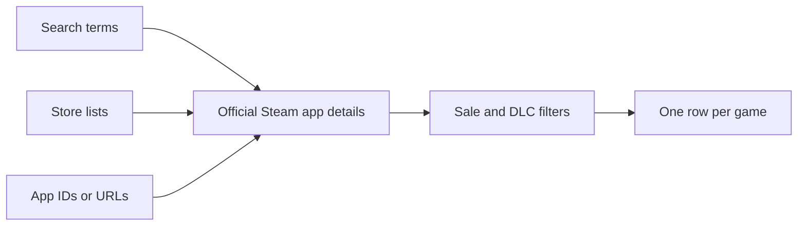

# Steam Store Scraper: Games, Prices, Discounts and Developers

[](https://apify.com/Turboextract/steam-games-prices)
[](LICENSE)
[](#pricing)

**Get Steam games by search term, store list or app ID, with price, discount, release date, developer, publisher, genres, platforms, Metacritic score, review count, website and support email.** Read the Specials, Top sellers, New releases and Coming soon lists in any country's currency. Uses the official Steam store APIs, so there is no login.

In one test, the actor returned 48 games from a search, two store lists and an app ID. 36 had a support email and 34 were on sale.

**Try it now →** [apify.com/Turboextract/steam-games-prices](https://apify.com/Turboextract/steam-games-prices)

---

## Why this exists

- Steam shows prices and developer details one game page at a time.
- Discounts change daily and differ by country.
- Game market tools charge monthly and focus on big titles.
- Indie developers list a support email on Steam, but there is no way to export them.

---

## Who this is for

- **Game publishers and studios** tracking competitor prices and launches
- **Game marketing agencies and PR** finding indie developers to pitch, with contact emails
- **Deal sites and bots** watching discounts by country
- **Analysts** comparing genres, release dates and review counts
- **Researchers** building game market datasets

---

## What you get

```json
{
  "appId": 730,
  "name": "Counter-Strike 2",
  "type": "game",
  "url": "https://store.steampowered.com/app/730/",
  "isFree": true,
  "price": 0,
  "originalPrice": null,
  "discountPercent": null,
  "releaseDate": "Aug 21, 2012",
  "developers": ["Valve"],
  "publishers": ["Valve"],
  "genres": ["Action", "Free To Play"],
  "platforms": ["windows", "linux"],
  "metacriticScore": null,
  "recommendations": 5357972,
  "dlcCount": 1,
  "website": "http://counter-strike.net/",
  "supportEmail": null,
  "source": "appId",
  "country": "us"
}
```

---

## How it works



---

## Quick start

1. Click **Try for free**.
2. Add **Search terms**, pick **Store lists**, or paste **App IDs or store URLs**.
3. Optional: set **Country** for prices, or turn on **Only games on sale**.
4. Click **Start**, then export to CSV, JSON or Google Sheets.

### API

```bash
curl -X POST "https://api.apify.com/v2/acts/Turboextract~steam-games-prices/run-sync-get-dataset-items?token=YOUR_TOKEN" \
  -H "Content-Type: application/json" \
  -d '{
    "storeLists": ["specials", "new_releases"],
    "country": "gb",
    "onlyOnSale": true
  }'
```

### Python

```python
from apify_client import ApifyClient

client = ApifyClient("YOUR_TOKEN")
run = client.actor("Turboextract/steam-games-prices").call(run_input={
    "searchTerms": ["roguelike", "city builder", "cozy farming"],
})
for g in client.dataset(run["defaultDatasetId"]).iterate_items():
    print(g["name"], g["developers"], g["supportEmail"], g["price"])
```

---

## Input fields

| Field | Default | What it does |
|---|---|---|
| `searchTerms` | – | Up to 10 games per term |
| `storeLists` | – | Specials, Top sellers, New releases, Coming soon |
| `appIds` | – | App IDs or store URLs |
| `country` | us | Prices and currency for this country |
| `onlyOnSale` | false | Only discounted games |
| `includeDlc` | false | Keep DLC and soundtracks |
| `includeDescription` | false | Adds short description and languages |
| `maxResults` | 200 | Total cap per run |

---

## Pricing

**$0.003 per game delivered.** 1,000 games cost $3.

| Option | 1,000 games |
|---|---|
| **Steam Store Scraper** | **$3**, with developer contacts |
| Other Steam actors on Apify | $0.50 to $3, most for reviews only |
| Game market data tools | $50+ a month |

---

## Common use cases

- **Price and discount tracking**: daily prices by country for a game list
- **Developer outreach**: indie studios with `supportEmail` and `website`
- **Launch monitoring**: New releases and Coming soon every day
- **Competitor research**: genres, prices and review counts in your niche
- **Deal alerts**: Specials with `onlyOnSale`
- **Release calendars**: Coming soon games by genre for coverage planning

---

## Tips for best results

- Steam search returns up to 10 games per term, so use several specific terms, like `roguelike deckbuilder` and `roguelite`.
- Steam limits how fast store details load, so expect about 35 games a minute.
- `recommendations` is Steam's count of positive and negative user reviews.

---

## Pairs well with

- [App Store Scraper](https://apify.com/Turboextract/app-store-charts-apps): the same view for iPhone apps and games
- [B2B Lead Enrichment Pipeline](https://apify.com/Turboextract/b2b-lead-enrichment-pipeline): more contacts from studio websites
- [Telegram Channel Scraper](https://apify.com/Turboextract/telegram-channel-scraper): gaming community channels

---

## FAQ

**Do I need a Steam account or API key?** No. The actor uses Steam's public store APIs.

**Does it include review text?** No. It returns the review count per game.

**Where do emails come from?** From the support contact each developer lists on its Steam store page.

**Which currencies work?** Any Steam store country, set by two-letter code.

**Is it legal?** It uses Steam's public store data. Follow privacy laws like GDPR when you contact developers.

---

## SEO keywords

Steam scraper, Steam store API, Steam game prices, Steam discount tracker, Steam sales scraper, scrape Steam games, Steam developer emails, indie game developers list, Steam new releases, game market data

---

## Support

- Actor page: https://apify.com/Turboextract/steam-games-prices
- Issues and questions: open an issue in this repo
- Community Discord: https://discord.gg/8SrXSCpvgj

Built and maintained by [Turboextract](https://apify.com/Turboextract) on the Apify platform.

---

## License

The documentation and examples in this repository are MIT licensed. The actor itself runs on the Apify platform.
